  <kbd>⌘</kbd>&nbsp;<kbd>K</kbd>
  &nbsp;&nbsp;·&nbsp;&nbsp;
  <code>type to filter</code>
  &nbsp;&nbsp;·&nbsp;&nbsp;
  <kbd>↵</kbd> to open

 

## ◌ &nbsp;Overview

<table>
<tr>
<td width="50%" valign="top">

Software Engineer at **[NearForm](https://nearform.com)** building tools and applications for the web. Co-founder of **[Deen Developers](https://deendevelopers.com)** — a community for Muslim developers to connect, learn, and grow together.

Stack-agnostic. I use whatever is needed to ship the best product.

</td>
<td width="50%" valign="top">

###### Metadata

| | |
|:--|:--|
| `role` | Software Engineer |
| `company` | NearForm |
| `based` | West Yorkshire, UK |
| `stack` | Whatever ships |
| `status` | 🟢 &nbsp;Available |

</td>
</tr>
</table>

 

## ◌ &nbsp;Actions

<table width="100%">
<tr>
<td width="44" align="center"><code>01</code></td>
<td width="36" align="center">→</td>
<td width="180"><strong>Visit Website</strong></td>
<td>Personal site &amp; writing</td>
<td align="right"><code>umar.codes</code></td>
<td align="right" width="80"><a href="https://umar.codes">Open ↗</a></td>
</tr>
<tr>
<td align="center"><code>02</code></td>
<td align="center">→</td>
<td><strong>Follow on X</strong></td>
<td>Thoughts on building &amp; AI</td>
<td align="right"><code>@UmarrGora</code></td>
<td align="right"><a href="https://twitter.com/UmarrGora">Open ↗</a></td>
</tr>
<tr>
<td align="center"><code>03</code></td>
<td align="center">→</td>
<td><strong>Connect on LinkedIn</strong></td>
<td>Professional profile</td>
<td align="right"><code>umar-gora</code></td>
<td align="right"><a href="https://linkedin.com/in/umar-gora-34a810a7">Open ↗</a></td>
</tr>
<tr>
<td align="center"><code>04</code></td>
<td align="center">→</td>
<td><strong>Follow on Instagram</strong></td>
<td>Life &amp; behind-the-scenes</td>
<td align="right"><code>@umarr.g</code></td>
<td align="right"><a href="https://instagram.com/umarr.g">Open ↗</a></td>
</tr>
</table>

 

## ◌ &nbsp;Currently

<table width="100%">
<tr>
<td width="44" align="center"><code>·</code></td>
<td>Deep in the <strong>AI / LLM</strong> space — building tools, agents, and workflows.</td>
</tr>
<tr>
<td align="center"><code>·</code></td>
<td>Building <a href="https://github.com/umxr/sage-code"><strong>sage-code</strong></a> — a self-improving learning plugin for Claude Code.</td>
</tr>
<tr>
<td align="center"><code>·</code></td>
<td>Engineering at <a href="https://nearform.com"><strong>NearForm</strong></a>.</td>
</tr>
<tr>
<td align="center"><code>·</code></td>
<td>Growing the <a href="https://deendevelopers.com"><strong>Deen Developers</strong></a> community.</td>
</tr>
</table>

 

## ◌ &nbsp;Recent Activity

  
  &nbsp;
  

  

 

---

  
    <kbd>↵</kbd>&nbsp;Open&nbsp;Profile
    &nbsp;&nbsp;·&nbsp;&nbsp;
    <kbd>⌘</kbd>&nbsp;Actions
    &nbsp;&nbsp;·&nbsp;&nbsp;
    <kbd>ESC</kbd>&nbsp;Close
    &nbsp;&nbsp;·&nbsp;&nbsp;
    <code>umxr</code>&nbsp;·&nbsp;<code>v.2026</code>
  

  

